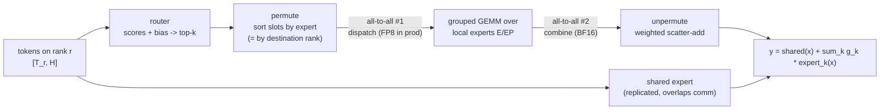
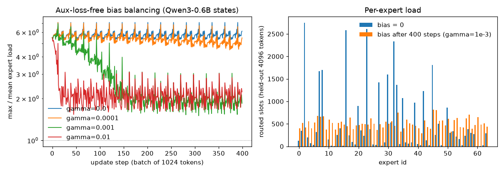
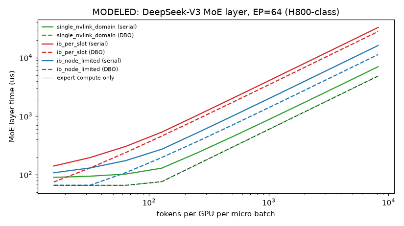

# MoE Expert-Parallel Router

A from-scratch, didactic **Mixture-of-Experts layer** in the DeepSeek-V3 / Qwen3-MoE style, plus **expert parallelism (EP)**:

- top-k gating (sigmoid or softmax), group-limited routing, a **shared expert**, and **auxiliary-loss-free bias load balancing**
- token **permutation** (dispatch / combine), **capacity factor and token dropping**
- five expert-compute back-ends, from a **naive per-expert loop** to a **from-scratch Triton grouped GEMM**
- EP as `dispatch -> all-to-all -> expert compute -> all-to-all -> combine`, run both as **real processes** (`torch.distributed`, gloo, 4 CPU ranks) and as **virtual ranks** in one process
- load-balance metrics (max/mean, CV), **communication-volume accounting**, a simplified **EPLB** (expert replication)
- an **analytic all-to-all model** for DeepSeek-V3 at EP=64 over NVLink vs InfiniBand, calibrated against DeepEP's published numbers, with and without **dual-batch overlap**

About 1,500 lines of Python (src + tests + benchmarks). Everything on the GPU was measured on one laptop RTX 5070 Ti. Everything at cluster scale is **modeled**, and labeled as such.

> Measured vs modeled. **Measured on this machine:** back-end timings, Triton kernel correctness, load balance on real Qwen3-0.6B hidden states, capacity drop rates, per-rank grouped-GEMM time under EP=8 (ranks run one after another on one GPU), gloo EP correctness and byte counts. **Modeled (arithmetic, no cluster):** every NVLink / InfiniBand / H800 / NVL72 time in the cost-model section.

---

## 1. The problem in one picture

A dense FFN makes every token pay for every parameter. An MoE layer has `E` small FFNs ("experts"), and a router sends each token to only `k` of them. DeepSeek-V3 has 671B parameters, but each token activates only 37B. That buys parameter count without FLOPs. The price is moved elsewhere:

1. **Irregular compute.** Each expert gets a different, data-dependent number of tokens. That is a *grouped* GEMM with variable group sizes, not one big GEMM.
2. **Load imbalance.** If the router likes some experts, those experts (and the GPUs that hold them) become stragglers. Everyone else waits.
3. **Communication.** At DeepSeek-V3 scale the experts do not fit on one GPU. With EP each GPU holds `E/EP` experts, so every token's hidden vector must be **sent** to the GPUs holding its experts and the results **sent back**: two all-to-alls per MoE layer, 58 MoE layers per forward pass.



## 2. The math, with numbers

### 2.1 Routing (`src/moe_ep/router.py`)

For token `x` and router matrix `W_r [E, H]`:

```
s   = sigmoid(W_r x)               (DeepSeek-V3)   or softmax(W_r x)  (Qwen3)
idx = topk(s + b, k)               selection uses the BIASED score
g   = s[idx] / sum(s[idx])         the weight uses the UN-biased score
y   = shared(x) + routed_scale * sum_j g_j * Expert_{idx_j}(x)
```

The bias `b` is a buffer, not a parameter. After each step:

```
b_e <- b_e + gamma * sign(mean_load - load_e)
```

Because `b` only changes *which* experts are picked, and never the weight `g`, no gradient from the balancing rule reaches the LM loss. That is the whole point of "auxiliary-loss-free" balancing (Wang et al., arXiv:2408.15664). The classic Switch/GShard aux loss `E * sum_e f_e P_e` is included (`switch_aux_loss`) for comparison only.

Two implementation details that matter:

- The router runs in **fp32**, and the bias stays fp32 even after `model.to(bfloat16)` (`TopKRouter._apply`). bf16 has 8 mantissa bits, so thousands of ±1e-3 updates on a bias of size ~0.1 would round to nothing.
- **Group-limited routing.** Experts are split into `G` groups (one per node in DeepSeek-V3: 8 groups, `topk_groups=4`). A token first keeps its best 4 groups, scored by the sum of each group's top-2 affinities, and then picks top-8 inside them. This caps how many *nodes* a token travels to. That is what bounds InfiniBand traffic (section 5).

### 2.2 Dispatch = a stable sort (`dispatch.py`)

Each of the `T*k` slots `(token t, expert e, weight g)` is flattened and **stable-sorted by expert id**. The per-expert counts (`bincount`) are the group sizes for the grouped GEMM. Because experts are placed contiguously on ranks (rank `r` owns `[r*E/R, (r+1)*E/R)`), *sorted by expert is also sorted by destination rank*. The send buffer is therefore already in `R` contiguous chunks, and the split sizes come from `counts.reshape(R, -1).sum(1)`. Combine is the transpose: `out.index_add_(0, token_idx, y * g)`, accumulated in fp32.

**Capacity factor.** Fixed-shape systems give each expert `C = ceil(cf * T * k / E)` rows. With `T=4096, k=8, E=64, cf=1.25`, that is `C = 640`. Slots past `C` are **dropped**: the token loses that expert's contribution, and only the residual stream and the shared expert carry it. Because the sort is stable, the earliest tokens win (GShard positional priority). Dropless systems (MegaBlocks, DeepSeek-V3, Qwen3) use variable-size groups instead.

### 2.3 Expert compute (`experts.py`, `triton_grouped_gemm.py`)

Each expert is a SwiGLU MLP, `(silu(x W_g) * (x W_u)) W_d`, with weights stacked as `[E, H, 2I]` and `[E, I, H]`. Each routed row costs `2 * 3 * H * I` FLOPs. For Qwen3-30B-A3B (`H=2048, I=768, k=8`) that is 75.5 MFLOP per token: tiny, narrow GEMMs per expert.

| back-end | what it does | why it is slow or fast |
|---|---|---|
| `naive` | HF-Mixtral style: `for e in E: torch.where(idx==e)`, then 2 GEMMs | E host syncs plus about 4E launches of tiny GEMMs |
| `sorted_loop` | permute once, loop over contiguous slices | no masking, but still E small GEMMs |
| `padded_bmm` | pad each group to the max count, one `bmm` | few launches, but FLOPs wasted on padding (this is what a capacity buffer looks like) |
| `grouped_mm` | `torch._grouped_mm` (CUTLASS) with `offs` | one variable-size grouped GEMM per projection |
| `triton` | our kernel: one launch, row tiles map to experts by binary search over a cumsum of tiles, no host sync | no padding, no syncs |

The Triton kernel sizes its grid by the upper bound `sum_e ceil(c_e/BM) <= ceil(N/BM) + E`, so the host never needs the counts, and surplus programs exit at once. Tiles never cross a group boundary (masked rows), which is the same invariant MegaBlocks and CUTLASS grouped GEMMs keep.

### 2.4 Communication volume (`metrics.py`, `cost_model.py`)

For one dispatch, one token row is `H * bytes` (DeepSeek-V3 FP8 + one fp32 scale per 128 elements gives 7168 × 1.031 = **7,392 B**). How many copies leave the GPU depends on the scheme:

- **per-slot** (plain `all_to_all_v`): `k * (1 - 1/EP)` = 8 × 63/64 = **7.875** copies per token
- **per-rank dedup** (send once per destination GPU, fan out on arrival): `E[#distinct GPUs hit] * (1-1/EP)` = **7.56**. That is little gain at EP=64, because 8 experts out of 256 rarely share a GPU. With `E=32, k=4, EP=4` the expected saving is 1 − 2.82/4 = **29.5%**, and the gloo run measured **29.7%**.
- **node-limited** (DeepSeek-V3 + DeepEP): at most 4 nodes per token, IB once per *remote node*, then NVLink forwarding. That gives **3.18** IB copies per token instead of 7.875, a 2.5× cut on the slow link.

Worked example, decode, 128 tokens per GPU: per-slot over IB is 128 × 7.875 × 7392 B = 7.45 MB. At 50 GB/s that takes 149 µs, plus α = 10 µs, so **159 µs**. DeepEP's measured EP64 low-latency dispatch is **173 µs**.

## 3. Repository map

```
src/moe_ep/
  config.py              MoEConfig + real DeepSeek-V3 / Qwen3-30B-A3B shapes
  router.py              top-k gating, group-limited routing, aux-loss-free bias, Switch aux loss
  dispatch.py            permute / unpermute, capacity + dropping
  experts.py             SwiGLU expert bank, 5 compute back-ends
  triton_grouped_gemm.py from-scratch Triton grouped GEMM
  layer.py               MoELayer (router + routed + shared) and a dense fp32 oracle
  metrics.py             max/mean, CV, rank loads, per-slot vs dedup byte matrices
  ep.py                  EP forward per rank (gloo) and virtual-rank simulation
  cost_model.py          analytic all-to-all, roofline expert time, DBO, simplified EPLB
benchmarks/              bench_backends.py, bench_balance.py, bench_ep_gloo.py, model_a2a.py
tests/                   21 tests: every path vs the dense oracle, gloo EP, capacity, bias, EPLB, model
results/                 JSON + PNG produced by the benchmarks below
```

## 4. How to run

```bash
pip install -r requirements.txt        # torch>=2.8; triton for the GPU back-end
pytest -q                              # 21 tests, ~40 s (CPU; GPU tests run if CUDA is present)
python benchmarks/model_a2a.py         # analytic model, no GPU
python benchmarks/bench_ep_gloo.py     # 4 gloo CPU processes, tiny tensors
python benchmarks/bench_backends.py    # GPU: back-end comparison (Qwen3-30B-A3B layer shape)
python benchmarks/bench_balance.py     # GPU: routes real Qwen3-0.6B hidden states (cached ~64 MB, not committed)
```

On the shared development machine every GPU job went through a machine-wide lock script, so that at most two heavy jobs run at once.

## 5. Results

**Hardware / software:** NVIDIA GeForce RTX 5070 Ti Laptop GPU (Blackwell, sm_120, 12 GB), AMD Zen 5 laptop CPU, Windows 11 (WDDM), Python 3.12.13, torch 2.11.0+cu128, triton-windows 3.5.1. The GPU was **shared with other jobs** during the runs, so absolute timings are noisy. Each JSON records `nvidia-smi` utilization at start.

### 5.1 Expert compute back-ends (measured)

This is one Qwen3-30B-A3B MoE layer (H=2048, I=768, E=128, top-8, softmax, no shared expert), bf16, random weights. Each cell times the full routed path (router -> permute -> experts -> combine): median of CUDA-event timings in ms. The two numbers in each cell are two separate runs, **run 1 / run 2** (`results/backends_run1.json`, from an earlier revision of the script that did not yet record ceilings or kernel lists, and `results/backends.json`). Both ran while other jobs were using the same GPU. Run 2 ran under heavier load: its same-run dense bf16 GEMM ceiling was only **22 TFLOPS** and device copy **354 GB/s**. Every back-end matches the naive output: rel. error 0 for the same-math paths, up to 4e-3 for padded/Triton, which is bf16 accumulation order.

| backend | 16 tok | 128 tok | 512 tok | 2048 tok | 8192 tok |
|---|---|---|---|---|---|
| `naive` | 191.2 / 366.8 | 312.3 / 584.2 | 243.9 / 625.2 | 260.7 / 780.4 | 217.1 / 766.9 |
| `sorted_loop` | 54.8 / 108.5 | 89.5 / 190.8 | 77.2 / 250.5 | 84.4 / 522.2 | 90.5 / 224.1 |
| `padded_bmm` | 11.4 / 15.6 | 12.4 / 17.1 | 12.1 / 35.8 | 24.4 / 396.4 | 99.4 / 209.5 |
| `grouped_mm` | 27.3 / 44.9 | 39.0 / 77.0 | 35.8 / 88.7 | 54.1 / 442.6 | 85.1 / 113.8 |
| **`triton`** (ours) | **8.0** / 14.3 | **11.1** / 17.8 | **10.1** / 42.9 | **19.6** / 276.4 | **57.1** / **65.9** |
| best TFLOPS | 0.15 / 0.08 | 0.87 / 0.56 | 3.84 / 1.08 | 7.90 / 0.56 | 10.84 / 9.39 |

How to read it:

- **The absolute numbers are inflated by GPU sharing.** On Windows/WDDM, CUDA contexts from different processes are time-sliced. A kernel can wait for another process's slice, which adds roughly milliseconds *per launch*. That is why even 16 tokens take milliseconds, and why run 2's 2048-token column spiked. On an idle GPU these would be tens to hundreds of µs. **The ranking is the result, not the milliseconds.**
- **Launch count is what separates the back-ends**, and contention amplifies it. `naive` does 128 `torch.where` host syncs, plus 256 tiny GEMMs and a gather and an `index_add_` per expert. `sorted_loop` drops the syncs to one, but keeps the 256 GEMMs (2 per expert). It is 2.5 to 4.5× faster than naive and still far behind.
- **`torch._grouped_mm` is not one kernel on this GPU.** The profiler at 2048 tokens shows **196 + 59 CUTLASS `sm80` GEMM launches plus 136 cuBLASLt split-K reduces**. That is about one GEMM per (expert, projection) pair: on sm_120 with torch 2.11 it behaves like a per-group loop of sm80 kernels, while on Hopper (sm_90) PyTorch ships a single fused grouped kernel. Our **Triton kernel is exactly 2 launches** (one per projection), so it wins at almost every size: 13× to 28× over `naive` from 16 to 2048 tokens and 3.8× at 8192 (run 1). The exceptions are run 2 at 128 and 512 tokens, where `padded_bmm` was as fast or slightly faster.
- **`padded_bmm` is competitive while load is even and groups are small** (few launches). It loses at 8192 tokens, because it runs 16% padding FLOPs (`pad_waste` 1.16), materializes `[E, cap, H]` buffers, and does a scatter in and out. With skewed load the waste grows with max/mean: at real Qwen3 hidden-state skew (5.4× max/mean, section 5.2) it would compute about 5× the useful FLOPs.
- **Small batches cannot saturate the GPU** whatever the layout. At 16 tokens × top-8 = 128 rows over 128 experts, the average group is 1 row, and the time is weight reads and launches: each expert holds 9.4 MB of bf16 weights, and about 63% of the 128 experts are hit, which is about 0.75 GB read to do 1.2 GFLOP. This is the decode regime that motivates EP: spread the weights so each GPU reads fewer of them.

Nsight Compute was not used. The roofline references are the dense GEMM and copy ceilings measured in the same run, and the kernel lists come from `torch.profiler` (stored in `results/backends.json`).

### 5.2 Load balancing on real hidden states (measured)

A router with random weights is almost perfectly balanced on isotropic Gaussian inputs, which hides the problem. Here we route **real Qwen3-0.6B layer-14 hidden states** (32,768 WikiText-2 tokens, RMS-normalised) through a 64-expert, top-8, sigmoid router with random weights. Real activations are anisotropic, so the load is badly skewed. The bias is trained for 400 steps of 1,024 tokens and evaluated on 4,096 held-out tokens.



| gamma (bias update speed) | max/mean load | CV | min/mean |
|---|---|---|---|
| 0 (no balancing) | 5.37 | 1.39 | 0.002 |
| 1e-4 | 4.46 | 1.06 | 0.014 |
| **1e-3** (DeepSeek-V3 value) | **1.60** | **0.22** | 0.58 |
| 1e-2 | 1.64 | 0.26 | 0.50 |

At γ=1e-2 the sign rule overshoots and oscillates, so it ends slightly worse than 1e-3. At 1e-4 it has not converged after 400 steps.

**Capacity factor**, held-out 4,096 tokens (C = cf · T · k / E):

| cf | C | dropped slots (unbalanced) | rel. output error | dropped slots (bias-balanced) | rel. output error |
|---|---|---|---|---|---|
| 1.0 | 512 | 52.5% | 0.66 | 8.7% | 0.28 |
| 1.25 | 640 | 46.6% | 0.62 | 1.9% | 0.13 |
| 1.5 | 768 | 40.8% | 0.58 | 0.27% | 0.05 |
| 2.0 | 1024 | 30.1% | 0.50 | 0% | 0 |
| 3.0 | 1536 | 14.5% | 0.34 | 0% | 0 |

Takeaway: a capacity factor without balancing is a disaster (half the routed compute dropped at cf=1). With aux-loss-free balancing, cf=1.25 to 1.5 drops under 2%. Dropless kernels (grouped GEMM) remove the trade-off entirely, which is why modern MoEs are dropless.

**EP=8 virtual ranks** (8 experts per rank, all 32k tokens = 262k slots). Per-rank grouped-GEMM time was measured with the Triton kernel on this GPU, ranks one after another:

| routing | rank load max/mean | slowest-rank time / mean | after EPLB (+2 replica slots per rank) |
|---|---|---|---|
| unbalanced | 1.82 | 1.44 | 1.002 (modeled load) |
| bias-balanced | 1.04 | 1.09 | 1.002 (modeled load) |

Rank load imbalance (1.82×) maps to compute stragglers (1.44× measured, less than 1.82× because small groups do not scale time linearly). Expert-level max/mean (5.37) is much worse than rank-level (1.82), because each rank sums 8 experts. EPLB's greedy replication plus packing brings rank load to 1.002×. That figure is computed from the load counts, not timed.

### 5.3 Real expert parallelism over gloo (measured, CPU)

4 processes, 512 tokens per rank, `E=32, k=4, H=512`, fp32. The EP output **matches the single-process layer** (`allclose`, checked on every rank). Dispatch row matrix `[src, dst]` (rows sent):

```
[[514, 504, 536, 494],
 [478, 533, 536, 501],
 [527, 557, 504, 460],
 [521, 533, 485, 509]]
```

Off-diagonal bytes: per-slot 12.56 MB, dedup 8.83 MB, a **29.7%** saving (theory 29.5%). Median rank-0 phase times: route+permute 13.6 ms, dispatch a2a 23.8 ms, experts 109.6 ms, combine a2a 26.6 ms, unpermute+shared 40.2 ms. Gloo over loopback TCP on a busy laptop says nothing about NVLink. These times only show the structure. The byte counts are exact.

### 5.4 DeepSeek-V3 at EP=64: NVLink vs InfiniBand (MODELED)

Setup: 256 experts, top-8, H=7168, I=2048, EP=64 (8 nodes × 8 GPUs), FP8 dispatch / BF16 combine. Bandwidths are DeepEP's *achieved* figures on H800: about 155 GB/s NVLink and about 50 GB/s RDMA per GPU. NVL72 is assumed at 630 GB/s (70% of spec). α = 10 µs is assumed, not fitted. Expert time is a roofline: H800 FP8 1979 TFLOPS × 0.6 and 3.35 TB/s × 0.8, both efficiencies assumed.

| tokens/GPU | fabric scenario | dispatch µs | combine µs | experts µs | layer serial µs | layer with DBO µs |
|---|---|---|---|---|---|---|
| 128 (decode) | single NVLink domain (NVL72) | 21 | 32 | 76 | 129 | 76 |
| 128 | IB, per-slot (naive a2a) | 159 | 299 | 76 | 534 | 458 |
| 128 | IB, node-limited (DeepEP normal) | 70 | 127 | 76 | 273 | 197 |
| 4096 (prefill) | single NVLink domain | 373 | 714 | 2431 | 3518 | 2431 |
| 4096 | IB, per-slot | 4779 | 9258 | 2431 | 16468 | 14037 |
| 4096 | IB, node-limited | 1933 | 3739 | 2431 | 8103 | 5672 |

**Calibration:** for 128 tokens at EP=64, the per-slot IB model gives **161 µs** dispatch and **304 µs** combine. DeepEP v1 reports **173 µs** and **314 µs** (implied 43.8 / 46.8 GB/s), so the model is within 7% at this point. This is one calibration point, not a validation across the curve.



What the model says:

- **Over InfiniBand, communication dominates**, even with node-limited routing (prefill: 5.7 ms comm vs 2.4 ms compute). This is why DeepSeek-V3 limits each token to 4 nodes, why DeepEP forwards IB to NVLink asymmetrically, and why dispatch is FP8.
- **Dual-batch overlap (DBO)** splits the batch into two micro-batches, so one micro-batch's all-to-all hides behind the other's attention/expert compute. The ideal is `max(comm, compute)` instead of the sum. It helps most when the two are comparable (node-limited decode: 273 to 197 µs). When comm is 4× compute, DBO can hide at most the compute part.
- **In a single NVLink domain** (GB200 NVL72, EP=64 inside one rack), comm falls well below compute, and DBO can fully hide it. This matches SGLang's report that two-batch overlap matters less on NVL72 (see `docs/SOTA.md`).
- **Imbalance multiplies everything.** Every term above assumes perfect balance. The slowest rank sets the pace, so a 1.8× rank imbalance (section 5.2) costs up to 1.8× on both comm and compute. Hence EPLB with redundant experts in production.

## 6. Limitations and what production does differently

- **One GPU, no fabric.** Virtual ranks run one after another on one GPU, and real ranks are CPU gloo processes. Nothing here measures NVLink, NVSHMEM or RDMA. All cluster numbers are modeled.
- **Kernels.** Production uses FP8 grouped GEMMs (DeepGEMM "contiguous" layout for prefill, "masked" layout for decode with CUDA graphs) and fuses permute/quantize into the dispatch kernel. Our Triton kernel is bf16, untuned beyond 4 autotune configs, and has no persistent/stream-K scheduling.
- **Dispatch.** DeepEP sends one copy per node over IB and forwards it over NVLink, overlaps comm without occupying SMs (low-latency hooks), and does the count exchange on the GPU. `gloo_all_to_all` does the count exchange through the host and sends per-slot copies.
- **Balancing.** We train only the bias, on frozen random router weights. There is no LM loss, so we show *balance*, not its effect on *quality*. DeepSeek-V3 also adds a tiny sequence-wise aux loss. Qwen3 uses a global-batch aux loss instead.
- **EPLB** here is a simplified "global" policy (greedy replication + greedy packing). The real one also has a hierarchical, node-aware policy and is fed with load statistics gathered over a time window.
- **The timings** were taken on a shared, WDDM laptop GPU. Treat ratios between back-ends as the result, not absolute milliseconds.

## 7. Exercises / next steps

1. Add a histogram + prefix-sum permutation (no `argsort`) and fuse the gather into the first grouped GEMM's A-load.
2. Make the Triton kernel FP8 (per-128 block scales) and compare against `torch._scaled_grouped_mm`.
3. Implement per-rank dedup dispatch in `ep.py` (send each token once per destination rank, fan out on arrival) and check that the measured gloo bytes match `CommVolume.dedup`.
4. Implement DBO for real: two micro-batches on two CUDA streams, with the "all-to-all" being a `copy_` on a side stream, and measure the overlap with `torch.profiler`.
5. Run EPLB online: re-place experts every N steps from a sliding window of loads, and plot rank max/mean over time.

## 8. Further reading

See [`docs/SOTA.md`](docs/SOTA.md) for sources and quoted numbers: DeepSeek-V3 (arXiv:2412.19437), aux-loss-free balancing (arXiv:2408.15664), Qwen3 (arXiv:2505.09388), MegaBlocks (arXiv:2211.15841), DeepEP, EPLB, DeepSeek profile-data, and SGLang's large-scale EP blogs.

---

Part of the **LLM inference engineering** series: https://github.com/Kripta-Studios/llm-inference-engineering-roadmap

License: MIT.
